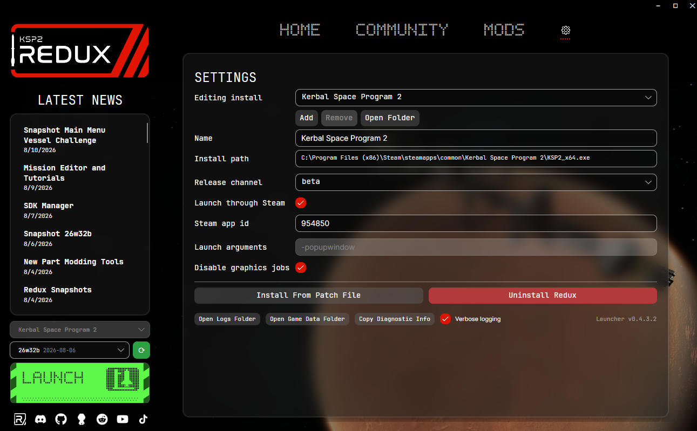

import { Aside } from '@astrojs/starlight/components';

本指南将带你完成在系统中安装KSP2 Redux的全过程。如果你只需要文件，请前往[下载页面](/download/)。

<Aside type="caution" title="测试版软件">
我们目前处于beta测试阶段。请注意，某些内容可能存在问题。
</Aside>

## 需求

- **KSP2版本：** 你必须拥有原版KSP2 v0.2.2.0版本（最新的官方版本）
- **磁盘空间：** 至少需要4 GB的可用空间用于存放新增资源
- **操作系统：** Windows或Linux（x64），或在装有Rosetta 2的Apple Silicon Mac上运行的macOS

## 安装步骤

### 1. 下载更新程序

请从[下载页面](/download/)获取适用于你的系统的Redux更新程序：Windows上为`Ksp2Redux-win-x64.exe`，macOS上为`Ksp2Redux-macos-arm64.dmg`，Linux上为`Ksp2Redux-linux-x64`。它始终是最新版本。

在Linux上，运行前请先将其标记为可执行文件：

```sh
chmod +x Ksp2Redux-linux-x64
./Ksp2Redux-linux-x64
```

<Aside type="note" title="在macOS上">
打开`.dmg`并将**KSP2
Redux**拖入**Applications**（应用程序）文件夹。由于更新程序尚未获得Apple签名，首次打开时macOS会提示无法验证该应用。请点击**完成**，然后前往**系统设置**、**隐私与安全性**，在关于KSP2
Redux的提示旁点击**仍要打开**，并使用密码或Touch ID确认。

KSP2从未发布Mac版本，Steam也不会在Mac上下载它，因此请在更新程序中登录Steam，并使用设置标签页中的**下载KSP2**来获取你的副本。更新程序会通过其自带的Wine运行时来运行游戏，无需CrossOver。
</Aside>

### 2. 运行更新程序

1. 运行已下载的更新程序
2. 在“设置”标签页中设置你的KSP2主程序路径（如果未能自动检测到的话）
3. 确保“设置”标签页中的发布渠道是你想要的（默认应该已设置好）
4. 返回“首页”标签页



### 3. 选择要安装的版本

在“首页”标签页的下拉菜单中，选择你要安装的版本

### 4. 安装

1. 点击**安装**
2. 等待进度条消失

### 5. 启动游戏

点击发射按钮

你也可以通过Steam/Epic启动游戏，或像平常一样运行游戏文件夹中的`KSP2_x64.exe`。

<Aside type="tip" title="在Linux上">
游戏本身通过Proton运行。如果你使用的是Linux，请阅读[Linux支持](/guides/linux-support/)，了解Proton版本、启动选项以及已知可用的配置。你还需要在更新程序的设置中启用**通过Steam启动**。
</Aside>

## 从命令行安装

此外还提供了命令行工具`redux-launcher-cli`，它可以在终端中完成与更新程序窗口相同的安装操作。它读写的是同一份配置，因此你可以在两者之间自由切换。它适用于Windows、macOS和Linux，且无需管理员权限。

使用一行命令即可安装，或从[下载页面](/download/#command-line)手动下载`redux-cli-x64.exe`（Windows）、`redux-cli-macos-arm64`（macOS）或`redux-cli-x64`（Linux）。在Mac上，请使用与Linux相同的`curl`命令：

```powershell
irm https://raw.githubusercontent.com/KSP2Redux/Updater/main/scripts/install-cli.ps1 | iex
```

```sh
curl -fsSL https://raw.githubusercontent.com/KSP2Redux/Updater/main/scripts/install-cli.sh | bash
```

在Windows上，这会将二进制文件放到`%LOCALAPPDATA%\Programs\redux-launcher-cli`，在Linux上则放到`~/.local/bin`，并将其添加到你的PATH环境变量中。再次运行安装程序即可就地升级。

之后的常规流程如下：

```sh
redux-launcher-cli --help         # 所有命令及示例
redux-launcher-cli detect         # 像更新程序那样查找KSP2
redux-launcher-cli installs add   # 将找到的主程序添加到配置中
redux-launcher-cli update         # 安装其渠道中的最新构建
redux-launcher-cli launch         # 启动游戏
```

通过`redux-launcher-cli self-update`可以让它自身保持最新，而`version
--check`会报告是否已发布更新的构建。它还会在你使用期间每天提示一次新版本，可用`--no-update-check`关闭。`self-uninstall`会移除该二进制文件，但不会改动你的配置。

用于脚本时，`--json`会将文档输出到stdout，其余内容输出到stderr，退出代码保持稳定，而`completion
pwsh|bash`会打印shell补全脚本。

## 验证安装

游戏启动后，你应该能看到Redux特有的功能和UI元素。请查看主菜单中的Redux版本信息。

## 故障排除

### 安装耗时过长
- 请检查你的杀毒软件是否在安装期间扫描文件
- 请确保你有足够的磁盘空间

### 游戏无法启动
- 请确保你的原版KSP2主程序为v0.2.2.0版本
- 在Windows上，请确保KSP2主程序的路径不要过长（最好在200个字符以内，Windows处理过长嵌套路径时可能会出问题）

### 文件缺失错误
- 通过Steam/Epic验证你原版KSP2主程序的文件完整性

## 卸载

要卸载KSP2 Redux，请进入更新程序的设置并点击卸载

## 报告问题

如果你遇到错误，请使用游戏内的错误报告功能：
- 按**Ctrl+B**，或者
- 按**Esc键** → **报告Redux错误**

这会自动附上截图、日志和存档等有用信息，帮助我们复现问题。

## 下一步

- 了解[模组兼容性](/guides/mod-compatibility/)
- 查看[更新日志](https://github.com/KSP2Redux/Redux/releases)
